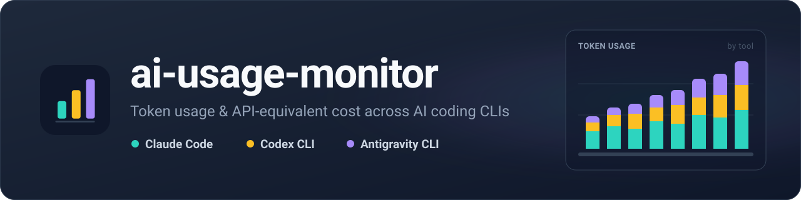

<p align="center"></p>

# ai-usage-monitor

> [!IMPORTANT]
> **이 저장소의 코드, 테스트, 문서, 빌드 스크립트는 전부 AI 코딩 에이전트(Claude Code 등)가 작성했습니다.**
> 사람은 요구사항을 정하고 결과를 검토·운영했을 뿐, 코드를 직접 작성하지 않았습니다.
> 자동 테스트와 개인 환경에서의 실사용으로 확인했지만 별도의 보안 감사는 거치지 않았습니다.
> 사용하기 전에 코드를 직접 검토하고, 본인 책임하에 사용하세요.

Claude Code · Codex CLI · Antigravity CLI 를 여러 기기에서 쓸 때, 각 기기의 로컬 로그에서 토큰 사용량을 읽어 한 서버로 모으고 모델별 API 단가로 환산한 비용을 대시보드로 보여주는 셀프 호스팅 도구입니다.

## 무엇을 볼 수 있나

- **개요** — 기간별 토큰·환산 비용 합계와 추이
- **에이전트 / 모델 / 프로젝트** — 도구별, 모델별, 작업 디렉터리별 사용량과 캐시 적중률, 분당 토큰
- **기기** — 기기별 사용량, 기기 관리(토큰 발급·재발급·폐기, 재동기화, 데이터 초기화·삭제)
- **이벤트** — 수집된 개별 호출 목록
- **단가** — 현재 적용 중인 단가표
- **다운로드** — OS 별 에이전트 설치·제거 명령

## 동작 방식

```
[기기 A] ai-usage-agent ─┐
[기기 B] ai-usage-agent ─┼── POST /api/v1/ingest (기기 토큰) ──> server ──> SQLite
[기기 C] ai-usage-agent ─┘                                         │
                                               브라우저 ──> 대시보드 (관리자 토큰)
```

- **에이전트** (`cmd/agent`)는 각 기기에서 OS 서비스로 돌며 아래 위치의 로그를 주기적으로(기본 60초) 읽어 서버로 보냅니다.

  | 도구 | 읽는 위치 |
  |---|---|
  | Claude Code | `~/.claude/projects` |
  | Codex CLI | `~/.codex/sessions` |
  | Antigravity CLI | `~/.gemini/antigravity-cli` |

  - **처음 실행하면 위 위치에 남아 있는 과거 이력 전체를 보내고**, 이후에는 읽은 위치(커서)부터 새로 생긴 기록만 보냅니다. 같은 호출은 서버에서 한 번만 저장되므로 다시 보내도 중복되지 않습니다.
  - 특정 도구를 빼거나 경로를 바꾸려면 에이전트 상태 디렉터리의 `config.json` 에서 `sources.<도구>.enabled` / `root` 를 고친 뒤 서비스를 재시작하세요.
  - 서버에 닿지 못하면 보낼 데이터를 로컬 큐에 쌓았다가 다시 보냅니다. 큐는 최대 500 MB 이고 넘치면 **오래된 것부터 버립니다**. 원본 로그가 남아 있다면 `ai-usage-agent rescan` 으로 다시 수집할 수 있습니다.

- **서버** (`cmd/server`)는 cgo 없는 단일 Go 바이너리입니다. SQLite 에 이벤트를 저장하고, JSON API 와 대시보드(React SPA, 바이너리에 내장)를 제공하며, 에이전트 바이너리와 설치 스크립트를 `/downloads/` 로 배포합니다.

## 수집하는 데이터

에이전트는 로그를 해석하기 위해 프롬프트·응답이 포함된 로그 레코드를 로컬 메모리로 읽지만, 그중 **사용량 메타데이터만 추출해 전송**합니다. 프롬프트, 응답, 파일 내용은 전송하지 않습니다.

서버로 보내는 항목:

- 시각, 도구 종류, 모델 이름, 도구 버전(로그에 있는 경우)
- 입력 / 출력 / 캐시 읽기 / 캐시 쓰기 / 추론 토큰 수
- 세션 ID, **작업 디렉터리 경로 또는 workspace URI**(프로젝트별 집계용)
- 중복 제거용 이벤트 ID, 기기 ID, 값의 신뢰도 표시
- 기기 정보: 호스트 이름, OS, 아키텍처, 에이전트 버전

작업 디렉터리 경로와 호스트 이름이 서버에 저장된다는 점에 유의하세요. 서버는 본인이 관리하는 곳에 두는 것을 전제로 합니다.

## 환산 비용에 대해

대시보드의 비용은 [`pricing.yaml`](pricing.yaml) 의 모델별 API 단가(USD / 1M 토큰)를 곱한 **추정치**입니다.

- 구독 요금제(Claude Pro/Max, ChatGPT Plus 등)의 실제 청구액과는 관계가 없습니다. "같은 양을 API 로 썼다면"의 값입니다.
- 단가표는 저장소에 들어 있는 값이며 자동으로 갱신되지 않습니다. 각 항목에 출처와 조회일이 주석으로 달려 있으니, 사용 전에 공식 가격 페이지와 대조해 직접 고쳐 쓰세요. 서버 재시작 없이 다시 읽을 수 있습니다(`POST /api/v1/pricing/reload`).
- 단가를 알 수 없는 모델의 사용량은 토큰 합계에는 포함되지만 비용 합계에서는 빠집니다. 따라서 표시되는 비용은 실제 사용량의 환산액보다 작을 수 있습니다.

## 빠른 시작

필요한 것: POSIX 셸(Linux / macOS, Windows 는 WSL), Go 1.27.1+, Node.js 22+ 와 npm

### 1. 서버 빌드와 실행

```sh
# 대시보드 빌드 (서버 바이너리에 내장됨)
(cd web && npm ci && npm run build)

# 에이전트 6종(linux/macOS/windows × amd64/arm64)과 설치 스크립트를 다운로드 디렉터리에 준비
VERSION=0.1.0 scripts/build-agents.sh cmd/server/kodata/downloads
cp scripts/install.sh scripts/install.ps1 scripts/uninstall.sh scripts/uninstall.ps1 cmd/server/kodata/downloads/

# 관리자 토큰 생성 (ASCII 문자열이어야 합니다). 이 값을 안전한 곳에 보관하세요.
export ADMIN_TOKEN="$(openssl rand -hex 32)"
echo "$ADMIN_TOKEN"

# 서버 실행 (기본: :8080, data/usage.db, pricing.yaml)
go run ./cmd/server
```

`ADMIN_TOKEN` 이 대시보드 로그인과 관리 API 의 비밀번호입니다. 설정하지 않으면 관리 API 는 모두 `503` 을 돌려줍니다.

설정 항목(포트, DB 경로, 단가표 경로 등)과 볼륨 구성은 [docs/DEPLOY.md](docs/DEPLOY.md) 를 참고하세요.

### 2. 기기 등록

브라우저에서 서버에 접속해 `ADMIN_TOKEN` 으로 로그인한 뒤 **기기 관리**에서 기기를 추가하면 기기 토큰(`aum_...`)과, 그 토큰이 채워진 설치 명령이 한 번만 표시됩니다.

### 3. 에이전트 설치

설치할 기기에서 위 명령을 실행합니다. **다운로드** 페이지에도 같은 형식의 명령(토큰 자리는 비어 있음)이 있습니다.

```sh
# Linux / macOS
curl -fsSL https://<서버>/downloads/install.sh | sh -s -- --server https://<서버> --token aum_...
```

```powershell
# Windows (관리자 권한 PowerShell)
powershell -ExecutionPolicy Bypass -c "& ([scriptblock]::Create((irm https://<서버>/downloads/install.ps1))) -Server https://<서버> -Token aum_..."
```

설치 스크립트는 기기에 맞는 바이너리를 내려받고, `manifest.json` 에서 해당 파일의 sha256 을 찾으면 대조해 검증합니다(찾지 못하면 검증을 건너뜁니다). 해시도 같은 서버에서 받으므로 전송 중 손상은 막지만 서버 자체를 신뢰하는 것을 전제로 합니다. 이후 OS 서비스로 등록합니다.

- Linux 는 root 면 시스템 systemd 서비스, 일반 사용자면 사용자 서비스(`systemctl --user`), macOS 는 launchd, Windows 는 Windows 서비스로 등록됩니다.
- 서비스 등록에 실패해도 설치 명령은 경고만 출력하고 끝납니다. 이 경우 출력된 `ai-usage-agent run --state-dir ...` 명령으로 직접 실행할 수 있습니다.
- 설치 후 `ai-usage-agent status` 와 대시보드의 **기기 관리**(마지막 수신 시각)로 데이터가 들어오는지 확인하세요.

### 서버 없이 이 기기의 사용량만 보기

`/downloads/` 의 바이너리는 `ai-usage-agent_<os>_<arch>` 이름으로 올라가 있습니다. 내려받아 바로 실행할 수 있습니다.

```sh
curl -fsSLo ai-usage-agent https://<서버>/downloads/ai-usage-agent_linux_amd64 && chmod +x ai-usage-agent
./ai-usage-agent scan                        # 최근 7일
./ai-usage-agent scan --since all --days 0   # 전체 이력
```

## 토큰과 보안

- **관리자 토큰**은 서버 환경변수로만 받고, 로그에도 찍지 않습니다. 대시보드에 로그인하면 브라우저 `localStorage` 에 저장되므로 공용 브라우저에서는 로그아웃하세요.
- **기기 토큰**은 서버에 해시만 저장되므로 잃어버리면 재발급해야 합니다. 에이전트 쪽에는 `config.json` 에 평문으로 저장됩니다(Unix 에서 권한 0600). 재발급하면 이전 토큰은 즉시 무효가 되므로 해당 기기에 다시 설치하세요.
- 인증 없이 열려 있는 경로: `/downloads/`(에이전트 바이너리·설치 스크립트), `/health`, `/api/v1/health`, `/health/live`, `/health/ready`. `/health` 는 서버 버전, 저장된 이벤트 수와 기기 수를 돌려줍니다. 필요하면 리버스 프록시에서 접근 범위를 제한하세요.
- 외부에 노출할 때는 반드시 HTTPS 리버스 프록시 뒤에 두세요. 서버 자체는 TLS 를 처리하지 않습니다.

## 에이전트 명령

```
ai-usage-agent scan       로컬 로그를 읽어 사용량 표 출력 (설정 불필요)
ai-usage-agent run        주기적으로 수집해 서버로 전송 (서비스가 실행하는 명령)
ai-usage-agent status     설정, 커서, 큐, 서버 연결 상태
ai-usage-agent rescan     커서와 큐를 비워 처음부터 다시 읽기
ai-usage-agent install    config.json 작성 + OS 서비스 등록
ai-usage-agent uninstall | start | stop | restart
```

상태(설정·커서·전송 큐·로그)는 Linux `~/.config/ai-usage-agent`, macOS `~/Library/Application Support/ai-usage-agent`, Windows `%APPDATA%\ai-usage-agent` 에 저장됩니다.

## 기기 관리와 제거

| 작업 | 서버의 기존 데이터 | 결과 |
|---|---|---|
| 재동기화 | 유지 | 에이전트가 로그를 처음부터 다시 보냄(중복은 무시) |
| 초기화 | 삭제 | 삭제 후 에이전트가 처음부터 다시 수집함. **수집 중단이 아님** |
| 토큰 재발급 | 유지 | 이전 토큰 무효, 기기에 새 토큰으로 재설치 필요 |
| 토큰 폐기 | 유지 | 이 기기의 전송을 더 받지 않음 |
| 완전 삭제 | 삭제 | 기기와 그 데이터를 모두 지움 |

기기에서 에이전트를 지우려면 `/downloads/uninstall.sh`(Windows 는 `uninstall.ps1`)를 실행합니다. 서비스와 바이너리, 로컬 상태(설정·커서·큐)를 지우며, 로컬 상태를 남기려면 `--keep-state`(Windows `-KeepState`)를 붙이세요. 서버 쪽 토큰 폐기나 데이터 삭제는 별도로 기기 관리에서 해야 합니다.

## 알려진 제한

- Claude Code · Codex 도 공식 API 가 아닌 로컬 로그 형식에 의존합니다.
- 관리자는 단일 토큰 하나뿐이며, 사용자·권한 구분이 없습니다. 개인 또는 소규모 기기군을 전제로 합니다.
- 서버는 SQLite 단일 인스턴스입니다. 수평 확장을 고려하지 않았습니다.
- 대시보드의 날짜 경계와 시각 표시는 `Asia/Seoul` 시간대로 고정되어 있습니다(API 는 `tz` 파라미터로 바꿀 수 있음).

## 개발

```sh
go build ./... && go vet ./... && go test ./...
(cd web && npm test)

# 대시보드 개발: 서버를 띄워 두고 Vite 개발 서버를 실행하면 /api 요청이 :8080 으로 프록시됩니다
ADMIN_TOKEN=dev go run ./cmd/server
(cd web && npm run dev)
```

`internal/collector/*/integration_test.go` 는 실행하는 기기의 실제 로그를 읽어 형식과 커서 동작을 확인하며, 로그가 없으면 건너뜁니다.

## 디렉터리 구성

```
cmd/agent      기기별 수집 에이전트
cmd/server     취합 서버
internal/      event, collector/{claudecode,codex,antigravity}, pricing, store, transport, httpapi
web/           대시보드 SPA (React + Vite + TypeScript)
scripts/       에이전트 빌드, 설치/제거 스크립트
pricing.yaml   모델별 단가
docs/          API 명세(API.md), 배포 설정(DEPLOY.md)
```

## 라이선스

[MIT](LICENSE)
