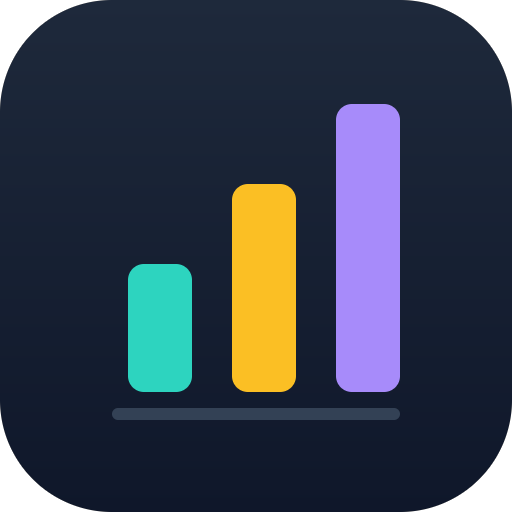

# ai-usage-monitor



Claude Code · Codex CLI · Antigravity CLI 의 토큰 사용량과 API 환산 비용을 여러 기기에서 수집해 한 곳에서 보는 서비스.


```
cmd/agent    기기별 수집 에이전트 (linux / macOS / windows)
cmd/server   취합 서버 (SQLite + JSON API + embedded SPA)
internal/    event, collector/*, pricing, store, transport, httpapi
web/         SPA (React + Vite + TS)
pricing.yaml 모델별 단가 (USD / 1M tokens)
```

```sh
go build ./... && go test ./...
```

아이콘: `assets/icon.png` (GitLab 아바타), `web/public/favicon.svg` (파비콘). 동일 도형을 `assets/icon_render.go.txt` 로 렌더링했다.
